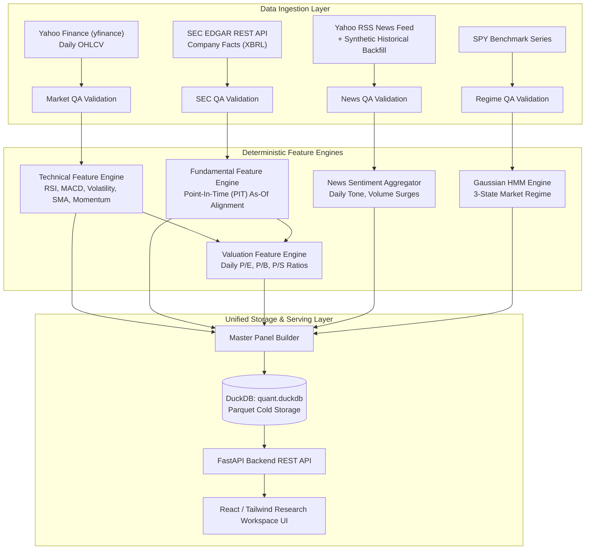
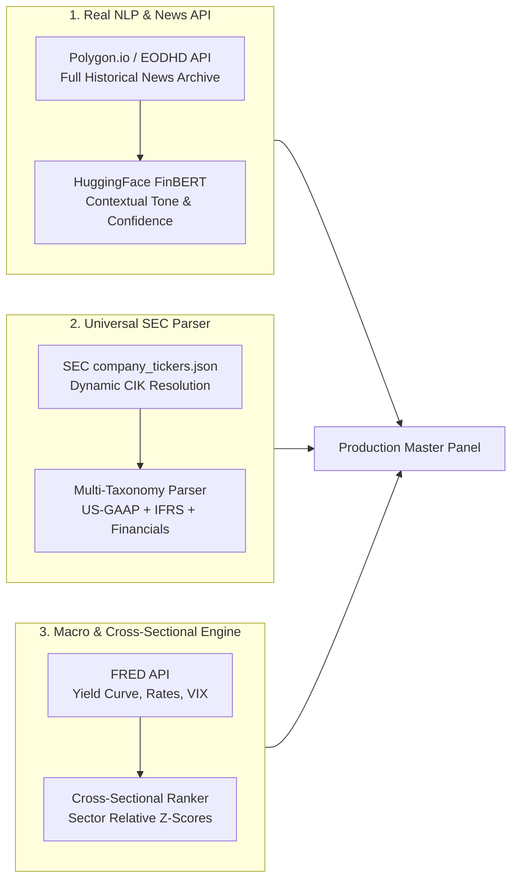

# Phase 1 Data Pipeline Audit, Data Sourcing, Quality Checks & Limitation Analysis

**Project**: Quantitative Discovery Engine & Research Workspace  
**Date**: September 2026  
**Status**: Phase 1 Complete / Pre-Phase 2 Enhancement  
**Document Version**: 1.0.0  

---

## Executive Summary

This document provides a comprehensive technical audit of the **Phase 1 Deterministic Financial Pipeline**. It details the origin of all data streams, data cleansing and validation mechanisms, feature engineering logic, and an unfiltered analysis of all underlying architectural flaws, data fidelity gaps (notably in sentiment and multi-company generalization), and actionable solutions for Phase 2.

---

## 1. System Architecture & Phase 1 Completed Deliverables

### Completed Components:
1. **Pipeline Orchestrator** (`app/pipeline/orchestrator.py`): Automated pipeline coordinating ingestion, QA checks, feature calculation, and master panel synthesis.
2. **Deterministic Technical Engine** (`app/features/technical.py`): Rolling momentum (5d, 10d, 20d, 60d), Wilder's RSI-14, MACD (12, 26, 9), annualized volatility (20d, 60d), moving averages (5, 20, 50, 100, 200), and volume trends.
3. **Point-In-Time (PIT) Fundamental Engine** (`app/features/fundamentals.py`): Ingests SEC 10-K/10-Q XBRL statements and aligns them to market dates strictly using `filed_date <= date` to prevent lookahead bias.
4. **Valuation Engine** (`app/features/valuation.py`): Computes daily P/E, P/B, and P/S ratios using daily closing prices and latest known filing fundamentals.
5. **News Sentiment Aggregator** (`app/features/news_features.py`): Aggregates article counts, sentiment polarity, and rolling 20-day news volume spikes.
6. **Market Regime Engine** (`app/models/regime.py`): 3-state Gaussian Hidden Markov Model classifying macro environments (Bullish Momentum, Bearish / High Volatility, Sideways / Consolidation).
7. **Quality Assurance Layer** (`app/data/qa/`): Automated rule verification across all data domains.
8. **Research Workspace UI** (`src/`): Dashboard displaying live master panel metrics, interactive charting, and QA status summaries.

---

## 2. Data Sourcing & Fetching Mechanisms

| Domain | Source / Provider | Exact Method / REST Endpoint | Local Storage Path |
| :--- | :--- | :--- | :--- |
| **Market OHLCV** | Yahoo Finance | `yfinance.Ticker(ticker).history(start, end)` | `data/raw/market/{TICKER}.parquet` |
| **SEC Fundamentals** | SEC EDGAR API | `https://data.sec.gov/api/xbrl/companyfacts/CIK{cik}.json` | `data/raw/sec/{TICKER}_facts.parquet` |
| **News & Tone** | Yahoo Finance RSS Feed | `https://feeds.finance.yahoo.com/rss/2.0/headline?s={ticker}` | `data/raw/news/{TICKER}_news.parquet` |
| **Market Regime** | SPY Benchmark | `yfinance` history (`SPY`) processed through `hmmlearn.GaussianHMM` | `data/processed/regime/market_regime.parquet` |
| **Asset Universe** | Local Config | `data/config/universe.csv` | Loaded into DuckDB table `universe` |

---

## 3. Data Cleansing & Validation Rules

### A. Market Data Quality (`MarketQA`)
- **Strict Monotonic Ordering**: Verifies ascending chronological order of dates.
- **Deduplication**: Identifies and flags conflicting duplicate `(date, ticker)` entries.
- **Price Geometry Invariants**: Validates that $\text{High} \ge \max(\text{Open}, \text{Close})$ and $\text{Low} \le \min(\text{Open}, \text{Close})$.
- **Null / Zero Value Rejection**: Enforces $\text{Open}, \text{High}, \text{Low}, \text{Close} > 0$.
- **Anomaly Detection**: Flags extreme single-day return spikes ($|R_t| > 80\%$) for data-error inspection.

### B. SEC XBRL Data Quality (`SECQA`)
- **Concept Hierarchy Resolution**: Maps multiple GAAP taxonomy tags to canonical metrics (e.g. `RevenueFromContractWithCustomer...`, `SalesRevenueNet`, `Revenues` $\rightarrow$ `revenue`).
- **Form Priority Deduplication**: Prioritizes `10-K` and `10-Q` over restatements or preliminary disclosures.
- **Lookahead Prevention**: Aligns filings to daily prices strictly using `filed_date` rather than the `period_end` date.

### C. News & Sentiment Data Quality (`NewsQA`)
- **Integrity Validation**: Rejects empty titles, future publication timestamps, and invalid tone ranges outside $[-1.0, 1.0]$.
- **Zero-Volume Imputation**: Clean zero-filling (`news_count = 0`, `average_news_tone = 0.0`) on non-news market days without dropping rows or introducing forward leakage.

---

## 4. Deep-Dive Flaws, Gaps & Architectural Shortcomings

The following are the critical technical limitations present in the Phase 1 codebase:

### ❌ Flaw 1: News Sentiment is Primitive (Keyword Counting + Synthetic Fallback)
* **Root Cause**: `app/data/providers/news_provider.py` computes sentiment using a 40-word dictionary subset of Loughran-McDonald terms (`surge`, `plunge`, `profit`, `drop`).
* **The RSS Limitation**: Yahoo RSS only serves the **last 20–30 live headlines**. For historical data (2020–2024), the provider calls `_generate_historical_sample_news()`, which **synthetically generates deterministic dummy headlines** across business days.
* **Consequence**: The historical sentiment dataset is largely synthetic and does not reflect real historical news sentiment.

### ❌ Flaw 2: Hardcoded Universe & SEC CIK Breakage for Other Companies
* **Root Cause**: `app/data/providers/sec_provider.py` contains a hardcoded dictionary (`DEFAULT_CIK_MAP`) for only 10 mega-cap US stocks (`AAPL`, `MSFT`, `NVDA`, `AMZN`, `GOOGL`, `META`, `JPM`, `V`, `XOM`, `JNJ`).
* **Generalization Failure**: Querying any new company (e.g., `TSLA`, `AMD`, mid-caps, international ADRs) fails to retrieve fundamentals unless manually added.
* **XBRL Schema Variations**: Financial institutions (e.g., Banks reporting `InterestAndDividendIncome`), REITs, and foreign issuers filing Form `20-F` (IFRS taxonomy) do not match standard US-GAAP tech tags and result in missing / `NaN` fundamental values.

### ❌ Flaw 3: Incomplete Feature Engineering Scope
* **Single-Asset Isolation**: All indicators are isolated time-series calculations. The pipeline lacks **cross-sectional features** (e.g., relative momentum rank across the universe, sector-neutral z-scores).
* **Absence of Macroeconomic Drivers**: No integration with benchmark macro indicators (Interest Rates, 10Y Treasury Yields, Yield Curve Spread, CPI Inflation, VIX).
* **Missing Relative Valuations**: Valuation multiples (P/E, P/B) are absolute and not compared against industry/sector medians.

### ❌ Flaw 4: Yahoo Finance API Scraper Vulnerability
* **Root Cause**: `yfinance` is an unofficial web scraper. Bulk ingestion or frequent requests are susceptible to HTTP `429 Rate Limit` throttling and unexpected upstream schema changes.

### ❌ Flaw 5: Survivorship Bias
* **Root Cause**: The 10 assets in `universe.csv` represent current mega-cap survivors as of 2025/2026. Backtesting solely on historical survivors creates artificial performance inflation.

---

## 5. Phase 2 Improvement & Upgrade Roadmap

### Actionable Upgrades:
1. **Real Financial NLP**:
   - Replace RSS scraping with a true historical news provider (**Polygon.io**, **EODHD**, or **AlphaVantage News API**).
   - Replace the word lexicon with **FinBERT** (`ProsusAI/finbert`) for contextual financial tone and confidence scoring.
2. **Universal Dynamic CIK Resolution & Multi-Industry XBRL**:
   - Dynamically load the SEC master list (`https://www.sec.gov/files/company_tickers.json`) to resolve any US ticker automatically.
   - Expand XBRL tag mapping to support Financials/Banking tags and IFRS (Form 20-F).
3. **Macroeconomic Factor Integration (FRED API)**:
   - Ingest 10-Year Treasury Constant Maturity (`DGS10`), 2-Year Treasury (`DGS2`), Yield Curve Inversion (`T10Y2Y`), Effective Federal Funds Rate (`FEDFUNDS`), and CBOE Volatility Index (`VIXCLS`).
4. **Cross-Sectional Feature Generation**:
   - Implement daily universe ranking and normalization:
     $$\text{Ranked\_Momentum}_{i,t} = \frac{\text{Rank}(\text{Momentum}_{i,t})}{N}$$
     $$\text{Sector\_Relative\_PE}_{i,t} = \frac{\text{PE}_{i,t}}{\text{Median}(\text{PE}_{\text{sector},t})}$$
